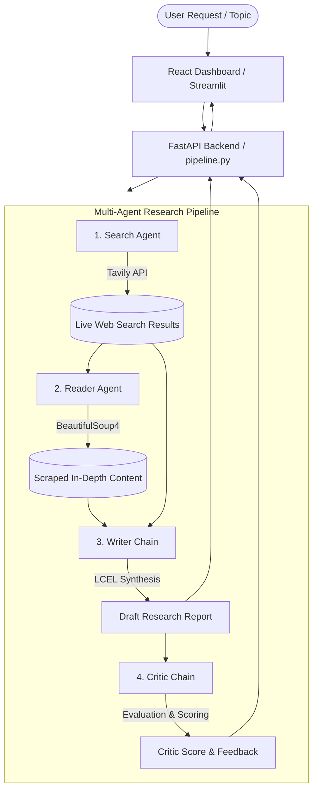

# 🧠 Multi-Agent Research System

[](https://www.python.org/)
[](https://fastapi.tiangolo.com/)
[](https://react.dev/)
[](https://vitejs.dev/)
[](https://python.langchain.com/)
[](https://langchain-ai.github.io/langgraph/)
[](https://groq.com/)

An autonomous multi-agent AI research platform that investigates any topic end-to-end. It orchestrates specialized agents to search the live web, scrape in-depth context from primary sources, synthesize a comprehensive report, and critically review its own work with editorial scores and actionable feedback.

Includes a **FastAPI** backend and an **interactive, modern React (Vite) UI** alongside classic **Streamlit** and **CLI** modes.

---

## 📸 Preview


---

## ✨ Features

- 🔍 **Autonomous Web Research (Search Agent)**: Uses Tavily's search engine to discover verified, real-time sources without hallucinating search results, preserving source links.
- 📖 **Deep Primary Source Extraction (Reader Agent)**: Analyzes search results, autonomously selects the most authoritative link, and extracts full clean text using BeautifulSoup.
- ✍️ **Structured Synthesis (Writer Chain)**: Synthesizes findings into a professional, news-grade report with Executive Summaries, Key Findings, Conclusions, and Source Citations.
- ⚖️ **Self-Correction & Editorial Review (Critic Chain)**: A dedicated editor agent grades the drafted report (/10), highlighting strengths, identifying factual/tonal blind spots, and issuing a final verdict.
- ⚡ **Interactive Modern React Dashboard**:
  - Live 4-stage pipeline visualization with real-time status pulses.
  - Multi-tab report viewer (Final Report, Critic Scorecard, Source Inspector, and Dual-Pane mode).
  - Research session history saved in browser `localStorage`.
  - Telemetry drawer showing token usage, agent timings, and latency.
  - One-click copy and Markdown export.
- 🔌 **Multiple Ways to Run**:
  - **Full-Stack Mode**: FastAPI backend (`http://localhost:8000`) + React Frontend (`http://localhost:5173`).
  - **Streamlit App**: Lightweight Python web UI (`app.py`).
  - **Direct CLI**: Run directly from your terminal (`pipeline.py`).

---

## 🏗️ Architecture & Workflow



---

## 📁 Repository Structure

```
.
├── agents.py             # Agent definitions (Search & Reader ReAct agents, Writer & Critic LCEL chains)
├── tools.py              # Web search tool (Tavily) & web scraper (BeautifulSoup4)
├── pipeline.py           # Core orchestrator running the 4-stage sequential pipeline
├── fastapi_app.py        # FastAPI REST API exposing the research pipeline
├── app.py                # Alternative Streamlit interactive web interface
├── HowToRun.txt          # Quick reference run guide
├── requirements.txt      # Python dependencies
├── screenshot.png        # UI screenshot
└── frontend/             # Modern React + Vite application
    ├── package.json      # NPM scripts and dependencies
    ├── vite.config.js    # Vite configuration
    ├── index.html        # Main HTML entry point
    └── src/
        ├── App.jsx       # Root dashboard component with pipeline execution state
        ├── index.css     # Design system, glassmorphism theme, animations
        └── components/
            ├── Header.jsx           # App navbar & backend connection indicator
            ├── Omnibar.jsx          # Search topic input & quick sample queries
            ├── PipelineTracker.jsx  # Visual progress tracker for the 4 agents
            ├── ReportViewer.jsx     # Markdown report renderer with download options
            ├── CriticReview.jsx     # Visual score badge, strengths & improvements
            ├── SourcesViewer.jsx    # Raw scraped data & citation inspector
            ├── Sidebar.jsx          # Session history and session management
            └── TelemetryDrawer.jsx  # Execution metadata, timings & metrics
```

---

## 🚀 Quick Start Guide

### 1. Prerequisites

- **Python 3.10+**
- **Node.js 18+** & **npm** (for the React frontend)
- API Keys:
  - [Groq API Key](https://console.groq.com/) *(or [Mistral API Key](https://console.mistral.ai/))*
  - [Tavily API Key](https://tavily.com/)

---

### 2. Backend Setup

1. **Clone the repository:**
   ```bash
   git clone https://github.com/I-AmKrrish/Multi-Agent-Research-System.git
   cd Multi-Agent-Research-System
   ```

2. **Create and activate a virtual environment:**
   - **Windows (PowerShell):**
     ```powershell
     python -m venv .venv
     .venv\Scripts\Activate.ps1
     ```
   - **Linux / macOS:**
     ```bash
     python3 -m venv .venv
     source .venv/bin/activate
     ```

3. **Install Python dependencies:**
   ```bash
   pip install -r requirements.txt
   ```

4. **Set up environment variables:**
   Create a `.env` file in the root directory:
   ```env
   GROQ_API_KEY=your_groq_api_key_here
   TAVILY_API_KEY=your_tavily_api_key_here

   # Optional (if using Mistral):
   MISTRAL_API_KEY=your_mistral_api_key_here
   ```

---

### 3. Running the Full-Stack Application (Recommended)

#### Terminal 1 — Start the FastAPI Backend:
```bash
uvicorn fastapi_app:app --reload --port 8000
```
*Backend API will run at `http://localhost:8000` (interactive Swagger docs at `http://localhost:8000/docs`).*

#### Terminal 2 — Start the React Frontend:
```bash
cd frontend
npm install
npm run dev
```
*Open your browser and navigate to `http://localhost:5173`.*

---

### 4. Alternative Ways to Run

#### Option A: Streamlit UI
If you prefer a pure Python interface:
```bash
streamlit run app.py
```

#### Option B: Terminal CLI
Run directly in your command line:
```bash
python pipeline.py
```

---

## 🛠️ Tech Stack

| Layer | Technology | Purpose |
| :--- | :--- | :--- |
| **Agent Framework** | [LangChain](https://www.langchain.com/) / [LangGraph](https://langchain-ai.github.io/langgraph/) | Agent creation (`create_agent`), tool binding, and LCEL chains |
| **Inference / LLM** | [Groq](https://groq.com/) / [Mistral AI](https://mistral.ai/) | High-speed LLM inference (`gpt-oss-120b`, `llama-3.3-70b-versatile`, `mistral-small`) |
| **Search Engine** | [Tavily Search API](https://tavily.com/) | Live, AI-optimized web queries & fact verification |
| **Scraper** | [BeautifulSoup4](https://www.crummy.com/software/BeautifulSoup/) + [Requests](https://requests.readthedocs.io/) | Parsing HTML and extracting clean article body text |
| **Backend API** | [FastAPI](https://fastapi.tiangolo.com/) + [Uvicorn](https://www.uvicorn.org/) | Async REST API endpoint with CORS support |
| **Frontend UI** | [React 18](https://react.dev/) + [Vite](https://vitejs.dev/) | Modern dark glassmorphic interface, state management & telemetry |
| **Alternative UI** | [Streamlit](https://streamlit.io/) | Instant Python prototyping interface |

---

## 🧠 Design Highlights & Engineering Decisions

1. **State Preservation**: The pipeline captures raw `ToolMessage` payloads to prevent URLs from getting lost during intermediate agent summarization.
2. **Separation of Concerns**: Tool-calling agents (Search & Reader) are decoupled from synthesis chains (Writer & Critic), reducing prompt pollution and token consumption.
3. **Automated Quality Gate**: The Critic Chain reviews the report before final presentation, providing a self-evaluation scorecard and actionable improvement notes.

---

## 📜 License

Distributed under the MIT License. Feel free to use, modify, and distribute this project for learning and building your own agentic workflows.